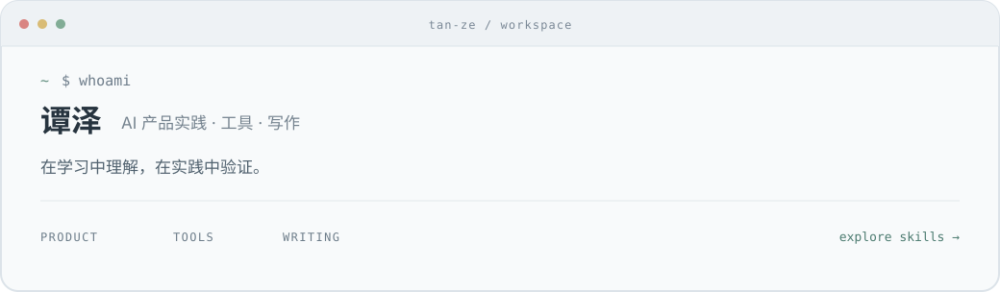

# Hi, I'm 谭泽 👋

<a href="https://github.com/evenk5838-coder/tan-ze-skills">
  <picture>
    <source media="(prefers-color-scheme: dark)" srcset="assets/workspace-dark.svg">
    
  </picture>
</a>

打开我的工作台 · Explore my skills

关注 AI 产品，做产品原型、小工具和可复用的 Skill。  
也写产品体验和生活随笔，记录做过的选择与具体的感受。  
这里放作品、方法，以及持续修改的过程。

[小红书](https://www.xiaohongshu.com/user/profile/674d9043000000001d02c61e) · 微信公众号：**TanZeAI**

[Projects](#featured-projects) · [Skills](#reusable-skills) · [Writing](#writing--thinking)

---

## Featured projects

🧰 [**tan-ze-skills · 个人 Skill 工具箱**](https://github.com/evenk5838-coder/tan-ze-skills)  
把中文写作与 AI 产品决策方法整理成可复用的工作流程。  
包含随笔、产品体验写作和立项报告三个 Skill，采用 MIT 许可证。

🎬 [**jianying-cut-to-create · 剪映概念网站**](https://github.com/evenk5838-coder/jianying-cut-to-create)  
剪映非官方产品概念网站。  
尝试用滚动影像叙事、功能章节和声音体验呈现产品。

---

## Reusable skills

| Skill | 用来做什么 |
| --- | --- |
| [**泽的随笔**](https://github.com/evenk5838-coder/tan-ze-skills/tree/main/skills/ze-essays) | 从真实生活细节写起，保留长句、口语与自嘲 |
| [**谭泽写作**](https://github.com/evenk5838-coder/tan-ze-skills/tree/main/skills/tan-ze-writing) | 写 AI 产品体验、行业观察，或只改文章中指定的部分 |
| [**立项报告**](https://github.com/evenk5838-coder/tan-ze-skills/tree/main/skills/project-initiation-report) | 梳理竞品、需求优先级、MVP、投入与风险，形成有依据的判断 |

---

## Writing & thinking

写产品时，关心它解决了什么问题、使用中发生了什么，以及判断从哪里来。  
写生活时，留意声音、动作和日常的小事，让感受沿着细节慢慢展开。
