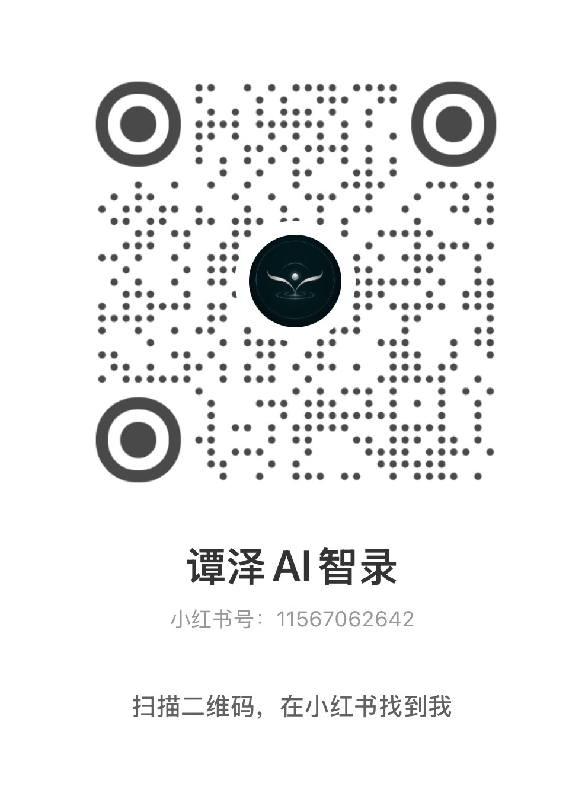

# Hi, I'm 谭泽 👋

<picture>
  <source media="(prefers-color-scheme: dark)" srcset="assets/workspace-dark-animated.svg">
  
</picture>

我是谭泽，关注 AI 产品设计与实践。这里整理我的产品项目、开源工具和文章，记录从问题、方案到实际体验的过程。

[精选项目](#精选项目) · [文章与记录](#文章与记录) · [找到我](#找到我)

## 精选项目

<table width="100%">
  <tr>
    <td width="50%" valign="top">
      <h3>物料间 · AIGC 电商平台</h3>
      
把商品与想法逐步做成图片、分镜和视频的 AI 创作工作台。

      
<a href="https://github.com/evenk5838-coder/ecommerce-aigc-workbench">开源仓库</a> · <a href="https://evenk5838-coder.github.io/ecommerce-aigc-workbench/">交互演示</a>

      
在线演示使用固定样例，不调用模型。

    </td>
    <td width="50%" valign="top">
      <h3>Vegan Agent · 蔬食助手</h3>
      
通过对话识别配料、寻找素食餐厅、搜索菜谱和管理冰箱食材。

      
<a href="https://github.com/evenk5838-coder/vegan-agent-public">开源仓库</a>

      
本地内测中。

    </td>
  </tr>
  <tr>
    <td width="50%" valign="top">
      <h3>AIGAME · 深探互动叙事</h3>
      
从剧本创作到角色选择、剧情分支与语音演绎，探索 AI 互动叙事。

      
<a href="https://github.com/evenk5838-coder/AIGAME">开源仓库</a>

      
本机单用户应用。

    </td>
    <td width="50%" valign="top">
      <h3>片刻 · Pianke</h3>
      
放在 Mac 菜单栏里的休息与专注小工具，为长时间工作留一点停顿。

      
<a href="https://github.com/evenk5838-coder/pianke-open-source">开源仓库</a>

      
Mac 体验版。

    </td>
  </tr>
  <tr>
    <td width="50%" valign="top">
      <h3>老G陪练 · 健身教练</h3>
      
围绕饮食、运动与日常行动，探索更容易坚持的健康陪伴。

      
<a href="https://sprightly-dragon-8ecc0e.netlify.app/">体验原型</a>

      
使用模拟对话，尚未接入真实 AI 陪练。

    </td>
    <td width="50%" valign="top">
      <h3>个人 Skill 工具箱</h3>
      
把中文写作与 AI 产品思考方法，整理成可复用的工作流程。

      
<a href="https://github.com/evenk5838-coder/tan-ze-skills">开源仓库</a>

      
写作 · 产品体验 · 立项报告。

    </td>
  </tr>
</table>

## 文章与记录

写 AI 产品体验、实践中的取舍，也写日常生活里具体的感受。

文章与更新见微信公众号 **TanZeAI** 和 [小红书](https://www.xiaohongshu.com/user/profile/674d9043000000001d02c61e)。

## 找到我

微信公众号：**TanZeAI** · 小红书：[**谭泽 AI 智录**](https://www.xiaohongshu.com/user/profile/674d9043000000001d02c61e)

欢迎通过小红书私信交流；项目问题也可以在对应仓库提 Issue。

<table>
  <tr>
    <th>微信公众号</th>
    <th>小红书</th>
  </tr>
  <tr>
    <td align="center" valign="top"></td>
    <td align="center" valign="top"></td>
  </tr>
</table>

点击二维码查看大图，或保存后在对应应用中识别。
